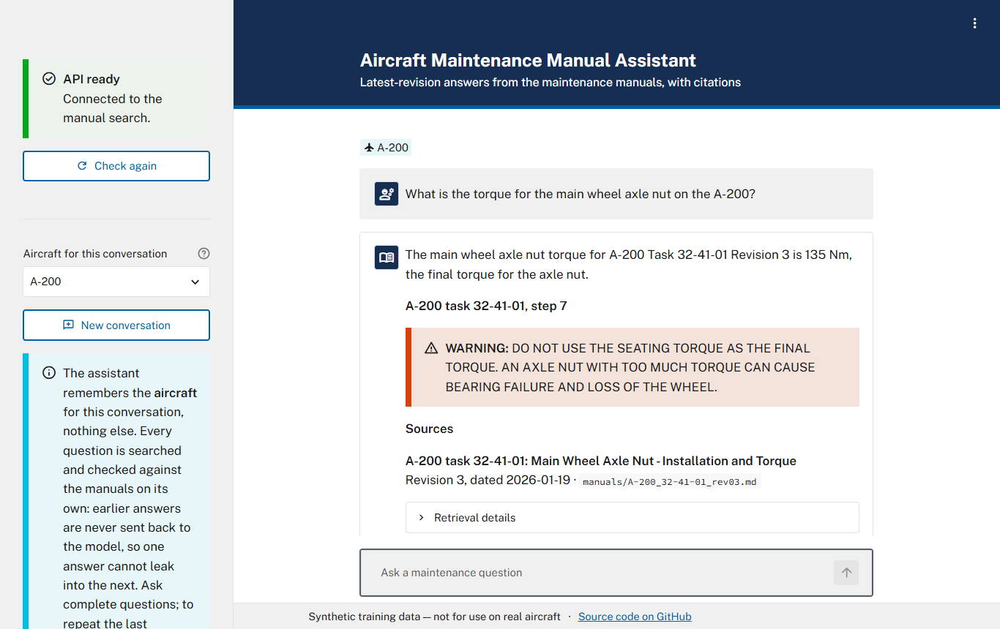
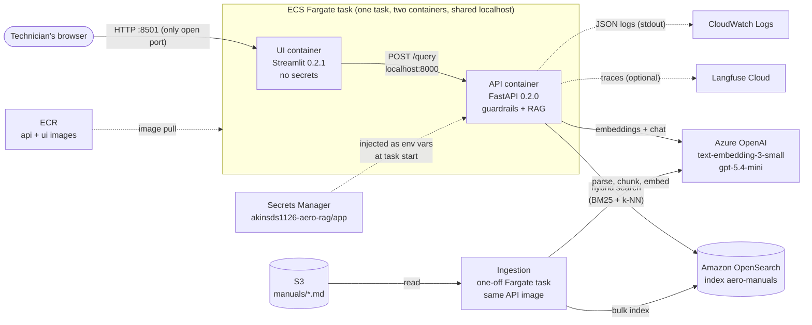

# Aircraft Maintenance Manual Assistant

A question-answering assistant for aircraft maintenance technicians. Ask "What is the torque for
the main wheel axle nut on the A-200?" and it answers from the **latest revision** of the
maintenance manual, with the complete procedure word for word, the WARNINGs and CAUTIONs of
the steps it relies on, and a citation (task, revision, date, source file) for every fact. When
the manuals do not cover the question, it says so instead of guessing.

Hybrid search (BM25 + vectors) on Amazon OpenSearch, answers from Azure OpenAI, deterministic
guardrails that check every torque value and part number against the cited task, and a
Streamlit chat UI. Everything runs on AWS ECS Fargate.



> **Synthetic data.** The three aircraft (A-200, B-340, C-75) and their 31 manual documents are
> fictional, generated from one JSON spec, so every evaluation label is correct by construction.
> Not for use on real aircraft.

## Contents

[The problem](#the-problem-the-wrong-revision) ·
[Architecture](#architecture) ·
[AWS services](#aws-services-and-why) ·
[Request flow](#request-flow) ·
[Guardrails](#guardrails) ·
[Security](#security-choices) ·
[Metrics](#metrics) ·
[Observability](#observability) ·
[UI design](#ui-design) ·
[Run locally](#run-locally) ·
[Deploy](#deploy) ·
[Cost and teardown](#cost-and-teardown) ·
[Limitations and future work](#limitations-and-future-work)

## The problem: the wrong revision

Maintenance manuals are revised all the time, and the old revisions stay in the document store.
In this corpus the A-200 main wheel axle nut torque is **120 Nm in revisions 1 and 2 and 135 Nm
in revision 3**; the three documents are word for word identical apart from that value. A
search engine cannot tell them apart by meaning, and a language model given all three may
quote any of them. An answer from a superseded revision is a fluent, cited, *wrong* number.

So the system is built around one rule: **only the current revision can ever be an answer.**
The search filters on `is_latest = true` inside every sub-query, so superseded revisions are
never candidates, and an output check rejects any answer that cites one anyway. The other
risks get the same treatment: values that are not in the cited task, a procedure with a step
missing, an answer about the nose wheel when the manual covers the main wheel. Each is caught
by code, not left to the prompt.

## Architecture

The architecture as a Mermaid diagram (GitHub renders it):



Two paths share one code base (`src/aero_rag`):

- **Ingestion** (run once, or after the manuals change): read the Markdown manuals from S3,
  parse each task revision, chunk it, embed the chunks and index them in OpenSearch. It runs
  locally or as a one-off Fargate task from the API image with a different command.
- **Query** (every question): the UI sends one standalone question to the API, which searches,
  generates, verifies and returns a structured answer.

**Chunking.** Each task revision becomes one *parent* (the full task, not embedded) and two
*children* that are embedded and searched: `reference` (applicability, parts, torque table)
and `procedure` (all the numbered steps). A procedure is never split, a WARNING or CAUTION
always stays with its step, and every chunk starts with a one-line header (aircraft, task,
title, revision). Search runs on the children, then collapses to parents, and the model
receives the full parent text. That is how "list the steps" can return the complete procedure.

## AWS services and why

| Service | What it does here | Why this and not the obvious alternative |
|---|---|---|
| **S3** (`akinsds1126-aero-rag-docs`) | Holds the manual files that ingestion reads. | Durable and cheap, and the same code reads it from a laptop or from a Fargate task. A local folder would not exist inside a container. |
| **Amazon OpenSearch Service** (1 x t3.small.search, OpenSearch 2.19) | Stores the chunks with their vectors and metadata; runs the hybrid search. | One engine does keyword (BM25) *and* vector (k-NN) search, with metadata filters inside both. A vector-only database would miss exact part numbers like `A200-32-4112`, which carry almost no meaning to embed (see [Metrics](#metrics)). |
| **Secrets Manager** (`akinsds1126-aero-rag/app`) | The only place the Azure key, OpenSearch password and Langfuse keys exist. | Secrets never sit in the repo, the image, `.env` or the task definition text. ECS injects them at start-up; locally the code reads them with the SSO profile. |
| **ECR** (`akinsds1126-aero-rag-api`, `-ui`) | Private registry for the two images. | Same account and region as ECS, so pulls need no extra credentials. Tags are immutable and images are scanned on push. |
| **ECS on Fargate** | Runs one task with two containers (API + UI); also runs the one-off ingestion task. | No servers to patch, billed per second. A Lambda function would hit its timeout and cold-start limits on a two-model-call request; EC2 would mean managing a VM. |
| **IAM roles** | *Execution role:* ECS pulls images, writes logs, reads the secret for injection. *Task role:* what my code runs as, read-only on the one S3 bucket. | Two roles keep the application from reading secrets it was not handed, and from touching anything but its own bucket. |
| **CloudWatch Logs** (`/ecs/akinsds1126-aero-rag-api`) | Collects each container's stdout (streams `api/...` and `ui/...`). | The `awslogs` driver needs no logging code in the app. Logs are one JSON object per line, so Logs Insights can filter by field. |
| **VPC security group** | Lets the internet reach port 8501 (UI) only. | The API port 8000 is closed: the UI reaches the API over the task's shared `localhost`, which a security group does not affect. |

Every AWS resource is in `eu-west-2`, named `akinsds1126-...` and tagged `project=aero-rag`,
`env=dev`, `owner=akinlolu` (shared company account). Azure OpenAI is the one external model
provider; Langfuse Cloud is optional.

## Request flow

What happens to "What is the torque for the main wheel axle nut on the A-200?":

1. **UI** (Streamlit, port 8501). Small talk ("thanks", "hi") is answered locally with no API
   call. Otherwise the UI sends the message as **one standalone question** plus the
   conversation's aircraft to `POST /query`. Earlier answers are never sent, so one answer
   cannot leak into the next.
2. **Input guardrail.** Empty, too long (over 500 characters) or prompt-injection patterns →
   `rejected`, before any paid call.
3. **Aircraft.** Taken from the request, or detected in the question ("A-200", "a200"; not inside
   a part number such as `A200-32-4112`). If there is none, the search runs across all aircraft
   and is flagged as unspecified.
4. **Embed** the question (`text-embedding-3-small`, 1,536 dimensions).
5. **Hybrid search** in OpenSearch: a BM25 sub-query and a k-NN sub-query, **each filtered on
   `is_latest = true` and the aircraft**. The two scores are min-max normalised and averaged
   (weights 0.5 / 0.5). The top 5 children collapse to their parent tasks and the best 3 parents
   become the context.
6. **Retrieval guardrail.** A part or task number in the question that no result contains →
   abstain. Best cosine similarity below 0.35 with no exact identifier match → abstain. The same
   task on several aircraft with different values and no aircraft named → ask which aircraft
   (`clarification_needed`).
7. **Generation** (`gpt-5.4-mini`). Instructions only in the system message; the question and
   each source fenced in `<question>` / `<source>` blocks; a strict JSON schema; the model cites
   source ids, not free text.
8. **Output guardrail** (below). On failure, one retry with the problems listed, then a refusal
   whose wording is built by code.
9. **Response.** Code builds the citations and copies the WARNING/CAUTION text from the index:
   the model never writes safety text. The JSON has `status`, `answer`, `steps`, `warnings`,
   `citations`, `scores` and `request_id`.
10. **Telemetry.** One JSON log line per step to CloudWatch and one trace per request in
    Langfuse (sizes, scores, decisions, tokens, cost; no question text by default).

A query that reaches the model costs about **$0.002**.

## Guardrails

Deterministic code in [`src/aero_rag/guardrails/`](src/aero_rag/guardrails/), applied in
[`service.py`](src/aero_rag/service.py).

| Stage | Check | On failure |
|---|---|---|
| Input | Not empty, at most 500 characters, no prompt-injection patterns | `rejected` (no paid call) |
| Retrieval | A requested part/task number is found; similarity ≥ 0.35 unless an exact identifier matched | `abstained` |
| Retrieval | Same task on several aircraft and no aircraft named | `clarification_needed` with aircraft buttons |
| Output | Every part number and torque value in the answer appears in a cited task | retry once, then abstain |
| Output | Every citation is the latest revision | retry once, then abstain |
| Output | Returned steps are the complete procedure, word for word | retry once, then abstain |
| Output | Position words in the question (nose/main, left/right, inboard/outboard, forward/aft, upper/lower) do not contradict the cited task's title | retry once, then abstain, naming what the manual does cover |
| Output | Model refused although a part/task number from the question is in a source | retry once, naming that source |

The injection patterns are only a first filter. The real defences are structural: the model
can only return a fixed JSON shape, it never writes citations or safety text, and every value
it returns is checked against the sources. Unverified text is never shown.

## Security choices

- **No secrets in images, the repo or the UI.** Secrets exist only in Secrets Manager. ECS
  injects them into the **API container only**; the UI image holds Streamlit and three Python
  files, knows only `API_URL`, and never talks to Azure or OpenSearch. `.env` holds non-secret
  settings and is git-ignored; [`.env.example`](.env.example) documents every setting with no
  real values.
- **API closed to the internet.** Only 8501 (UI) is open in the security group; the API on 8000
  is reachable only from inside the task.
- **Non-root containers.** Both images run as an unprivileged user `app`. The API image's build
  context is an allow-list (`.dockerignore`) that admits only what the app needs (never `.env`).
- **Immutable image tags.** A pushed `0.2.0` can never be overwritten, so the task definition
  revision always names exactly the image that was tested. Images are scanned on push.
- **Task role vs execution role.** ECS's execution role pulls images, writes logs and reads the
  secret. The application's task role can only read the one S3 bucket.
- **Redaction everywhere.** Logs and traces pass through the same redaction of known secret
  values and host names. Error output shows the exception *type*, never the message, because
  messages can echo endpoints. Question text, prompts and model output are never logged.
- **Model text is escaped** before the UI displays it, so an answer can never inject Markdown,
  links or LaTeX.
- **Shared account hygiene.** Every resource is prefixed `akinsds1126-` and tagged; AWS changes
  are run by a person from [docs/DEPLOY.md](docs/DEPLOY.md), not by tooling.

## Metrics

All numbers come from one command, `uv run python scripts/evaluate.py` (51 LLM calls, about
$0.14), run on 16 November 2026 against the live index: 47 questions written to sound like a
technician, labelled from the same JSON spec the manuals were generated from
([data/eval/questions.json](data/eval/questions.json)). Full tables:
[data/results/metrics.md](data/results/metrics.md); every question and outcome:
[data/results/questions.md](data/results/questions.md); what changed between runs:
[docs/EVALUATION.md](docs/EVALUATION.md).

### 1. The latest-revision filter, off vs on

13 "trap" questions ask about tasks whose older revision gives a different value (for example
the A-200 axle nut: 120 Nm in revisions 1 and 2, 135 Nm in revision 3).

| Latest-revision filter | Old revision in the model's context | Old revision ranked first | Model's first draft cites or quotes an old revision (v1 / v2) | Final answers citing an old revision (v1 / v2) |
|---|---|---|---|---|
| off | 13/13 (100%) | 7/13 (54%) | 1/12 / 0/13 | 0/12 / 0/13 |
| **on (default)** | **0/13 (0%)** | **0/13 (0%)** | **0/12 / 0/13** | **0/12 / 0/13** |

Without the filter, an old revision reached the model in every trap question and was ranked
first in more than half. No ranking method can separate documents that differ by one number.
In v1 the model's first draft for one question (the A-200 lock bolt) used a superseded
revision; the output guardrail rejected it and the retry was correct. Two layers: the filter
guarantees old revisions are never candidates, and the guardrail catches the rare slip when
the filter is off. (v1 has 12 rather than 13 because one question was not answered in v1.)

### 2. Headline results (hybrid search, filter on)

| Metric | v1 baseline | v2 | Target |
|---|---|---|---|
| **Answers citing an outdated revision** | **0/34 (0%)** | **0/34 (0%)** | **0** |
| Recall@5 (correct task in the top 5) | 1.00 | 1.00 | high |
| Exact match: torque values | 15/15 (100%) | 15/15 (100%) | 100% |
| Exact match: part numbers | 12/13 (92%) | 13/13 (100%) | 100% |
| Step completeness (text, WARNINGs, CAUTIONs intact) | 61/61 steps | 61/61 steps | 100% |
| WARNINGs and CAUTIONs kept with their step | 23/23 | 23/23 | 100% |
| Correct abstentions on unanswerable questions | 8/9 (89%) | 9/9 (100%) | 100% |
| Correct clarification requests (which aircraft?) | 4/4 | 4/4 | 100% |
| Answers containing a value from the wrong task | 0/34 | 0/34 | 0 |
| **Questions fully correct** | 45/47 (96%) | **47/47 (100%)** | high |
| LLM calls / cost | 52 / $0.131 | 51 / $0.136 | |

**v1 → v2.** Two failures were fixed:
- **A bare part number** ("B340-28-5209"): the model refused even though retrieval found the
  task. The fix is a prompt rule plus a code safety net that retries naming the source.
- **"Nose wheel axle nut" on the A-200:** the manual only covers the main wheel, and the model
  answered with the main wheel value. The fix is a prompt rule plus a deterministic
  position-word check against the cited title.

No other question changed outcome. Both fixes were written after seeing the failures, so 47/47
is in-sample for those two questions.

### 3. Keyword vs vector vs hybrid search

| Question type | n | Top-1 keyword | Top-1 vector | Top-1 hybrid | Recall@5 vector |
|---|---|---|---|---|---|
| torque | 11 | 1.00 | 1.00 | 1.00 | 1.00 |
| part number | 8 | 0.88 | 1.00 | 1.00 | 1.00 |
| procedure | 6 | 1.00 | 1.00 | 1.00 | 1.00 |
| no aircraft named | 4 | 1.00 | 1.00 | 1.00 | 1.00 |
| **bare part or task number** | 5 | 1.00 | **0.40** | 1.00 | **0.80** |
| clarification | 4 | 1.00 | 1.00 | 1.00 | 1.00 |
| **all** | 38 | 0.97 | 0.92 | **1.00** | 0.97 |

Vector search fails on bare identifiers: a code like "A200-32-4112" carries almost no meaning
to embed. Keyword search ranked the wrong task first for one plain-language question. Hybrid
was the only mode with every correct task ranked first. Recall@5 is 1.00 for keyword and
hybrid in every row.

**Caveats.** The corpus is small and synthetic (31 documents, 24 current tasks, 8 per aircraft
after the filter), so Recall@5 nearly saturates and each difference is one to three questions.
Six unanswerable questions overlap with the probes used to choose the 0.35 threshold. Each
result is one run of a model that is not fully deterministic.

## Observability

- **Langfuse (optional).** One trace per `/query`, with spans for input guardrail, aircraft
  detection, retrieval (mode, top-k, chunk ids, scores), abstain decision, generation (model,
  tokens, cost, latency) and output guardrail (pass / retry / abstain). Each trace is tagged
  with `status:`, `aircraft:` and `request_id:`. The trace id is derived from the request id, so
  the request ID shown under every answer in the UI finds its trace directly.
  - Tracing can never fail or slow a request: the first SDK error logs one warning and turns
    tracing off.
  - Traces are flushed on shutdown (ECS sends SIGTERM, then waits 30 s).
  - `LANGFUSE_CAPTURE_TEXT=true` adds the redacted question and final answer to the trace. It
    is on for this synthetic demo and **must be false for real, proprietary manuals**. It is
    never the prompt or the manual text.
- **CloudWatch Logs.** JSON lines from both containers in `/ecs/akinsds1126-aero-rag-api`
  (streams `api/` and `ui/`): request id, status, decisions, scores, citations, duration and
  model cost, never the question. Example Logs Insights query:
  `fields @timestamp, request_id, status, duration_ms, llm_cost_usd | filter ispresent(status) | sort @timestamp desc`.
- **Health.**
  - `GET /health`: the process is up. Used by the container health check and by the UI
    container's `dependsOn: HEALTHY`.
  - `GET /ready`: OpenSearch is reachable.
  - The UI sidebar shows both as a USWDS success, warning or error alert.

## UI design

The chat follows the [U.S. Web Design System](https://designsystem.digital.gov/) visual
language, so it would sit comfortably next to an aviation-authority website:
- USWDS colour tokens: primary `#005ea2`, a `#162e51` header bar, `#1b1b1b` text on white.
- Public Sans.
- 4px-radius solid and outline buttons.
- Left-border alerts: red for WARNING, amber for CAUTION, cyan for "no verified answer".

It **uses no agency's name, logo, seal or "official website" banner**: it is aligned with the
design system, not pretending to be an official site.

Accessibility:
- Every text and background pair meets WCAG AA (a test checks the contrast ratios).
- Keyboard focus has a visible 4px outline.
- Every icon is paired with text.
- The type is a little larger for a projector.

All styling is in [`ui/theme.py`](ui/theme.py), and all chat logic is in
[`ui/presenter.py`](ui/presenter.py) (pure functions, tested offline). [`ui/app.py`](ui/app.py)
is layout only.

In the chat:
- The conversation remembers only the aircraft (shown as a chip). It switches when a question
  names or implies another aircraft.
- Typing just "B-340" re-asks the last question for that aircraft.
- Small talk is answered without calling the API.

## Run locally

Prerequisites: Python 3.12 with [uv](https://docs.astral.sh/uv/), Docker Desktop, the AWS CLI with
an SSO profile `aero`, and access to the Secrets Manager secret.

```powershell
uv sync                                   # install dependencies
copy .env.example .env                    # non-secret settings; edit if your names differ
uv run pytest                             # offline tests: no network, no .env needed
aws sso login --profile aero
uv run python scripts/check_connections.py    # PASS/FAIL: Secrets Manager, S3, OpenSearch, Azure
```

**API + UI together, as on ECS** (recommended):

```powershell
.\scripts\compose_up.ps1                  # builds both images, waits until healthy
# UI:  http://localhost:8501     API docs: http://localhost:8000/docs
.\scripts\compose_up.ps1 -Down            # stop and remove
```

The script reads the secret into its own process and compose passes each value to the API
container by name, so nothing secret is written to disk. Locally the UI reaches the API at
`http://api:8000` (compose network); on ECS at `http://localhost:8000` (shared task network).

**Without Docker:**

```powershell
uv run python -m aero_rag.api                     # API on :8000
uv run --group ui streamlit run ui/app.py         # UI on :8501
uv run python scripts/search.py "brake bolt torque" --aircraft A-200 --mode hybrid  # search only
```

**Data and evaluation:**

```powershell
uv run python scripts/generate_manuals.py         # rebuild data/manuals/ from the spec (free)
uv run python -m aero_rag.ingestion --dry-run     # counts + cost estimate, writes nothing
uv run python -m aero_rag.ingestion               # S3 -> parse -> embed -> OpenSearch (~$0.0004)
uv run python scripts/evaluate.py --dry-run       # call count + cost estimate (free)
uv run python scripts/evaluate.py                 # full evaluation (~51 LLM calls, ~$0.14)
```

Configuration: every setting is listed in [`.env.example`](.env.example) and loaded through
`aero_rag.config.get_settings()`.

## Deploy

[docs/DEPLOY.md](docs/DEPLOY.md) is the step-by-step runbook (PowerShell). It covers creating
the ECR repositories, pushing images, registering task definitions
([deploy/ecs/](deploy/ecs/)), updating the service, finding the public IP, the security group
changes and rollback. The current release is **task definition revision 3**: API `0.2.0`, UI
`0.2.1`, one Fargate task (1 vCPU, 2 GB), port 8501 public.

## Cost and teardown

| Item | Rate (eu-west-2, approximate) |
|---|---|
| Fargate task, 1 vCPU / 2 GB | about $0.057 / hour |
| Public IPv4 address for the task | $0.005 / hour |
| OpenSearch t3.small.search + 10 GB gp3 | about $0.04 / hour + about $1 / month |
| Secrets Manager (one secret) | $0.40 / month |
| ECR storage, CloudWatch Logs | cents per month at this size |
| A question that reaches the model | about $0.002 (Azure OpenAI) |
| One full ingestion / one full evaluation | about $0.0004 / about $0.14 |

While everything runs this is roughly **$0.10 an hour, about $2.50 a day**, mostly Fargate and
OpenSearch. To pause, scale the service to zero (OpenSearch keeps costing):

```powershell
$P = @("--profile", "aero", "--region", "eu-west-2")
aws ecs update-service @P --cluster akinsds1126-aero-rag-cluster `
  --service akinsds1126-aero-rag-api-service-jk8marb6 --desired-count 0
```

**Full teardown** deletes data and cannot be undone. Run these yourself, in this order, after
checking each name:
1. **The ECS service.** It was created in the console, so the console's delete also removes its
   CloudFormation stack and security group. Then delete the cluster:
   `aws ecs delete-cluster @P --cluster akinsds1126-aero-rag-cluster`.
2. **Task definitions:** `aws ecs deregister-task-definition @P --task-definition akinsds1126-aero-rag-api:<n>`
   for each revision.
3. **ECR:** `aws ecr delete-repository @P --repository-name akinsds1126-aero-rag-api --force`,
   and the same for `akinsds1126-aero-rag-ui`.
4. **OpenSearch:** `aws opensearch delete-domain @P --domain-name akinsds1126-aero-rag`.
5. **S3:** `aws s3 rb s3://akinsds1126-aero-rag-docs --force @P`.
6. **Secret:** `aws secretsmanager delete-secret @P --secret-id akinsds1126-aero-rag/app --recovery-window-in-days 7`.
7. **Logs:** `aws logs delete-log-group @P --log-group-name /ecs/akinsds1126-aero-rag-api`.
8. **IAM roles** `akinsds1126-aero-rag-exec-role` and `akinsds1126-aero-rag-task-role`. List
   their policies first (`aws iam list-role-policies` and
   `aws iam list-attached-role-policies`), delete or detach each one, then run
   `aws iam delete-role`.

If the stack stays up, set log retention, which is currently "never expire":
`aws logs put-retention-policy @P --log-group-name /ecs/akinsds1126-aero-rag-api --retention-in-days 30`.

## Limitations and future work

**Limitations today**
- **No stable address or HTTPS.** The UI is plain HTTP on the task's public IP, which changes
  on every deployment.
- **Each question stands alone.** "And the torque for it?" does not know what "it" is. This is
  deliberate, so every answer is verified independently; type a complete question, or just an
  aircraft to repeat the last one.
- **Small, synthetic corpus.** Real manuals (tables, figures, effectivity by serial number,
  thousands of tasks) would make retrieval harder. The 0.35 abstention threshold would need
  re-tuning.
- **OpenSearch has a public endpoint** (HTTPS with fine-grained access control). In production
  it would sit inside a VPC with no public access.
- **Manual deployment.** A person runs the documented commands; there is no pipeline.
- **No authentication on the UI**, and no per-user audit trail.

**Future work**
1. **Application Load Balancer + HTTPS + a stable domain.**
   - An ALB in front of the service, an ACM certificate and a Route 53 name.
   - The task moves to private subnets, so it no longer needs a public IP.
   - Add sign-in (Cognito or the company's identity provider) on the ALB.
2. **Follow-up question rewriting.** Rewrite "and for the brakes?" into a standalone question
   from the conversation, show the rewritten question to the technician, and keep retrieval and
   verification independent of earlier answers.
3. **CI/CD.** GitHub Actions running tests and lint on every push, building and scanning both
   images, pushing an immutable tag, registering a task definition and deploying with the
   circuit breaker. The evaluation set would be a gate on prompt or retrieval changes.
4. **Agents, carefully.** A planner could chain tools the API already has: search, look up a
   part, compare revisions, open the full task. For example: "what changed between revisions 2
   and 3 of 32-41-01?", or a work-pack checklist across several tasks. Every tool result would
   go through the same deterministic guardrails, so the agent can choose what to look up but
   never invent a value.
5. **Production hardening.**
   - OpenSearch in a VPC with more than one node.
   - Secrets rotation.
   - Log retention and alarms on error rate and latency.
   - A fresh, unseen evaluation set to test whether the v2 fixes generalise.

## Repository layout

```text
src/aero_rag/       API, RAG service, guardrails, retrieval, ingestion, generation, tracing, config
ui/                 Streamlit chat: app.py (layout), presenter.py (logic), theme.py (USWDS styling)
data/spec/          manuals.json, the single source of truth for the synthetic manuals
data/manuals/       generated Markdown manuals (never edited by hand)
data/eval/          labelled evaluation questions;  data/results/  metrics and per-question results
deploy/ecs/         ECS task definitions (revisions 2 and 3)
docs/               DEPLOY.md (runbook), EVALUATION.md (run history), PLAN.md (design decisions)
scripts/            generate, evaluate, search, check connections, compose and container helpers
tests/              offline tests with fakes for Azure OpenAI, OpenSearch and S3
```
